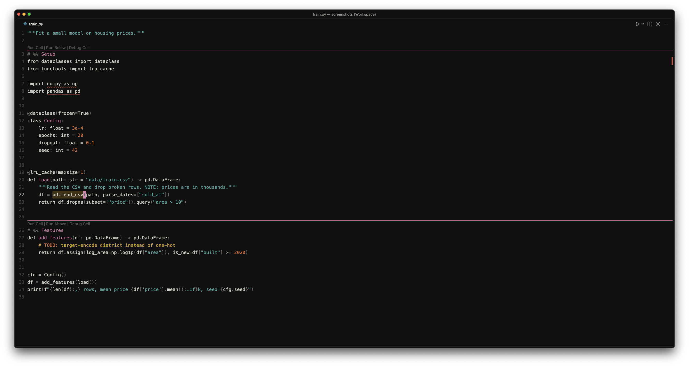

# An Alabaster

Minimal VS Code themes inspired by [Alabaster](https://github.com/tonsky/vscode-theme-alabaster). Most of the code is plain text. Color kept for definitions, literals, and comments.
Color palette by [Flexoki](https://stephango.com/flexoki) (Magenta, Blue, Purple, Orange) dark and light.

Made for Python, C++, Rust and TypeScript.

## Credits

- Alabaster and the idea behind it: Nikita Prokopov ([@tonsky](https://github.com/tonsky)) and his [essay on syntax highlighting](https://tonsky.me/blog/syntax-highlighting/).
- Flexoki palette: [Steph Ango](https://stephango.com/flexoki).

## License

[MIT](LICENSE)
